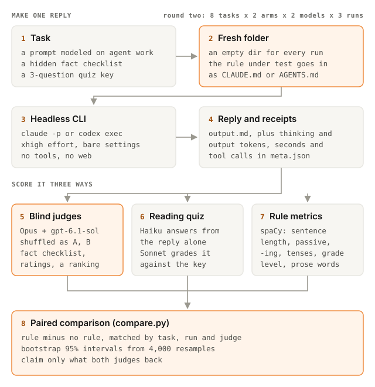

# STE eval: Simplified Technical English for coding agents

A popular tip says to make your coding agent write in ASD-STE100 Simplified Technical English (STE), the controlled English of aircraft maintenance manuals. This repo tests that on Claude Code (Claude Opus 5.5) and Codex (gpt-6.1-sol), both at xhigh effort. Over two rounds it collected 224 replies. Two blind judges from different model families scored every reply, a small model took a reading quiz on each one, and a script measured the STE rules directly.

- **The write-up:** [ASD-STE100 and LLMs: the myth, the legend, and what the evals say](https://blog.thakay.dev/asd-ste100-and-llms/)
- **Every reply side by side, with charts:** [the explorer](https://data.thakay.dev/ste-eval/)
- **Full results, decision matrix and limits:** [REPORT.md](REPORT.md)

## Results in short

Round two tests the tip as people share it. The CLIs ran bare (no user rules, no output style, no memories), and one arm got a single line as its `CLAUDE.md` or `AGENTS.md`: `Speak only in ASD-STE100`. That's 8 tasks x 2 models x 3 runs.

| One line minus bare (* = 95% interval excludes zero) | Claude Opus | Codex sol |
|---|---|---|
| Sentences over 20 words | 8.1% to 0.1% | 9.3% to 0.7% |
| Passive voice | 8.2% to 2.6% | 6.9% to 3.3% |
| Second-language ease (1-5) | +1.08* | +0.92* |
| Naturalness (1-5) | -1.56* | -0.75* |
| Nuance (1-5) | -0.62* | -0.92* |
| Overall (1-10) | -0.27 | -0.85* |
| Thinking tokens per reply | 1,677 to 5,245 (x3.1) | 913 to 1,709 (+87%) |
| Seconds per reply | 34 to 67 (x2) | 53 to 79 (+48%) |

Round one put three STE rule sets (187 to 2,639 words) on top of my own setup, which already had a one-line plain-language rule. It showed the same pattern. Second-language ease went up 0.4 to 0.6, naturalness went down, Codex lost 0.5 to 0.7 points (both judges scored it lower), and thinking rose 51 to 83%.

**Verdict:** the models know STE from its name alone, so the tip works on the surface. The cost lands on every reply, though, so I don't keep it always on. I use it as an on-demand rewrite for documents meant for second-language readers or translation.

## What's here

| Path | Contents |
|---|---|
| `dataset/tasks.json` | 8 tasks (procedure, explanation, tradeoff, handoff, incident, warning, code review, pushback), each with a hidden fact checklist and a 3-question quiz. The scenarios are invented: names, places, companies and incidents are fictional |
| `arms/` | Round one rule files. Lite and Scoped are my paraphrases. Full is [danyuchn/asd-ste100-skill](https://github.com/danyuchn/asd-ste100-skill) (MIT, notice in `arms/LICENSE-asd-ste100-skill.txt`) |
| `baseline/` | The round one baseline: my global `CLAUDE.md`, Codex `AGENTS.md` and Claude output style, as they stood during the runs. Lightly redacted: one private project name and one config-path comment removed. No rule changed. |
| `exp2/` | Round two: the one-line rule, configs, replies, scores |
| `runs/` | Round one replies, in `runs/<model>/<arm>/<task>/r<rep>/`: `output.md` (the reply), `meta.json` (tokens, time) and `raw.txt` (CLI output, run IDs redacted) |
| `scores/` | Judge verdicts, quiz grades, metrics, summary tables |
| `harness/` | Run, judge, quiz, metrics and analysis scripts, plus the prompt templates. `compare.py` is the generic two-arm analysis |
| `experiments/example/` | A ready-to-copy experiment for testing your own line (see below) |
| `METHOD.md` | The full design: every choice, the reason for it, and the threats to validity |
| `research/` | Notes on the standard and its evidence, and a survey of 23 STE skills on skills.sh |
| `explorer/`, `docs/` | Source and build of the explorer page, and the pipeline diagram |

## How it was run



[METHOD.md](METHOD.md) has the full design. In short:

- Each reply ran in a fresh empty folder under `/tmp`. The arm's rule file went in as `CLAUDE.md` or `AGENTS.md`, the same way a project file loads in real use.
- Every prompt ended with "(Answer directly from what you know. Do not run commands or look anything up.)" Codex ran with web search, apps and browser off in a read-only sandbox. None of the 224 replies made a tool call.
- Round two ran bare. Claude used `--setting-sources project,local`. Codex used a `CODEX_HOME` folder that holds only a link to `auth.json`.
- Judges were Claude Opus and gpt-6.1-sol at effort high. Each saw all replies for one model, task and run together, shuffled under letter labels with no hint of which rules produced them. It checked them against the fact checklist and returned JSON scores and a ranking. Each judge rates its own family higher, so I only claim results both judges back.
- In the reading quiz, Claude Haiku answered from the reply alone and Claude Sonnet graded the answers. The STE rule metrics come from spaCy (`harness/metrics.py`).

## Rerun round two

Round two is bare, so anyone with both CLIs signed in can rerun it. Round one also loads your own user rules, so it only reproduces my setup if you install the files from `baseline/`.

You need Linux or WSL, Python 3.10+, Claude Code (2.1.296 here) and the Codex CLI (0.160.0 here). If a CLI can't find node in a non-login shell, set `STE_NODE_BIN` to node's `bin` folder.

```bash
STE_EXP=exp2 python3 harness/run.py --reps 3 --jobs 8    # replies
STE_EXP=exp2 python3 harness/judge.py --jobs 12          # blind judges
STE_EXP=exp2 python3 harness/reader.py --jobs 12         # reading quiz
python3 -m venv .venv && .venv/bin/pip install -r requirements.txt
.venv/bin/python harness/metrics.py exp2/runs exp2/scores/metrics.csv
.venv/bin/python harness/analyze2.py                     # tables in exp2/scores/summary.md
```

The run, judge and quiz scripts skip work that already has output. To start clean, move `exp2/runs` and `exp2/scores` aside first. These calls cost real money: a full pass makes 48 Opus replies, 48 Codex replies, 96 judge calls and 96 quizzes.

## Test your own line

The harness can test any line you're thinking of adding to `CLAUDE.md` or `AGENTS.md`, not just STE. An experiment is a folder with an `arms.json` (what to compare), a `models.json` (which CLIs and flags), and optionally its own `tasks.json`. `experiments/example/` is ready to copy. It tests two lines (`Use active voice.` and `Use one term for one thing.`) against a bare CLI, and hasn't been run yet.

1. Copy it: `cp -r experiments/example experiments/my-rule`.
2. Put your line in `experiments/my-rule/rule.md`, and point `rules_file` in `arms.json` at it.
3. Optional: add `experiments/my-rule/tasks.json` in the same shape as `dataset/tasks.json`. Without it, the 8 tasks here are used. Each task needs a prompt, a fact checklist and three quiz questions with answers.
4. Look before you spend, smoke-test one task, then run the grid:

```bash
export STE_EXP=experiments/my-rule
python3 harness/run.py --tasks T1 --reps 1 --dry   # list the cells, no model calls
python3 harness/run.py --tasks T1 --reps 1         # smoke test: one task, both arms, both models
python3 harness/run.py --reps 3 --jobs 8           # the full grid; finished cells are skipped
python3 harness/judge.py --jobs 12
python3 harness/reader.py --jobs 12
.venv/bin/python harness/metrics.py $STE_EXP/runs $STE_EXP/scores/metrics.csv
.venv/bin/python harness/compare.py                # writes $STE_EXP/scores/compare.md
```

Read the smoke test's `output.md` and `meta.json` before the full grid. If Codex's `tool_calls` or Claude's web search count is above zero, or the reply shows a rule you didn't put in the folder, the isolation leaked.

`compare.py` treats the first arm in `arms.json` as the control and the second as the treatment (`--control` and `--treatment` override this). The shipped `models.json` runs both CLIs bare at xhigh effort. The judges are set in `harness/judge.py` (Claude Opus and gpt-6.1-sol at effort high). They run under your normal CLI settings, so your own user rules reach them too. METHOD.md covers this.

## Limits

- The judges are models. They agree only moderately (r = 0.45), and each favors its own family. Both judges score Codex lower with STE. The Claude result changes sign with the judge.
- Two runs of the same cell differ by 0.56 to 0.76 points on average, so per-task numbers are hints only.
- Every reply was a single turn without tools. Real sessions are mostly tool work.
- LLM readers handle long sentences well, so the quiz is a weak stand-in for a person reading in a second language. The only human rating is my own blind read of five pairs (N=1).

## Legal

ASD-STE100 is a trademark of ASD (the AeroSpace, Security and Defence Industries Association of Europe), and the standard's text and dictionary are copyrighted. This repo is not affiliated with or endorsed by ASD. It contains no rule text or dictionary entries from the standard. Lite and Scoped are my own paraphrases, and Full is a third-party skill under the MIT license. The survey's fetched copies are not included, because two of them ship the dictionary. `research/candidate-sources.md` lists where each one lives.

## License

Code is MIT (`LICENSE`). Data, replies and write-ups are [CC BY 4.0](https://creativecommons.org/licenses/by/4.0/). `arms/ste-full.md` is MIT, copyright Dustin Yuchen Teng.
